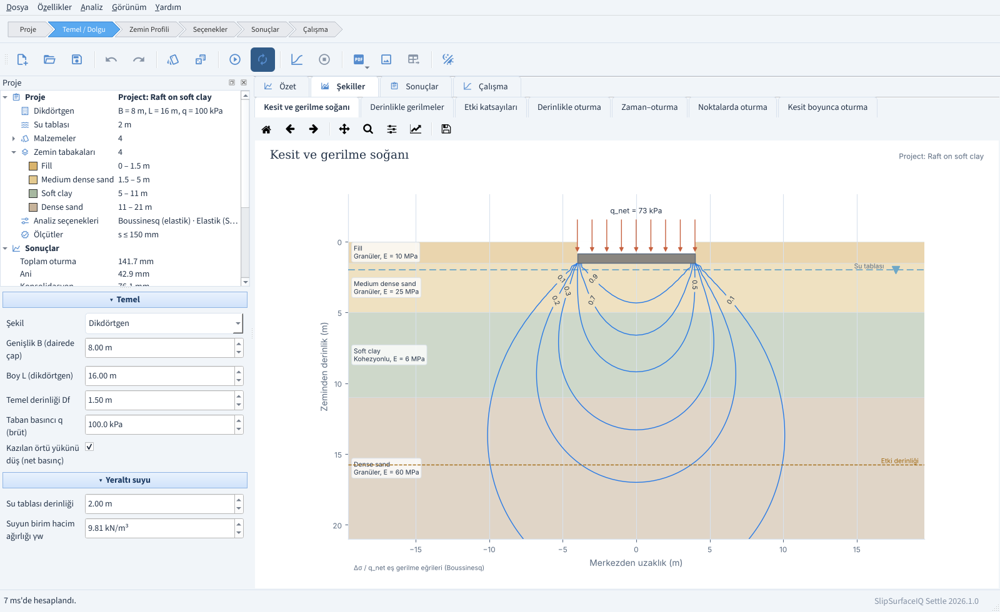
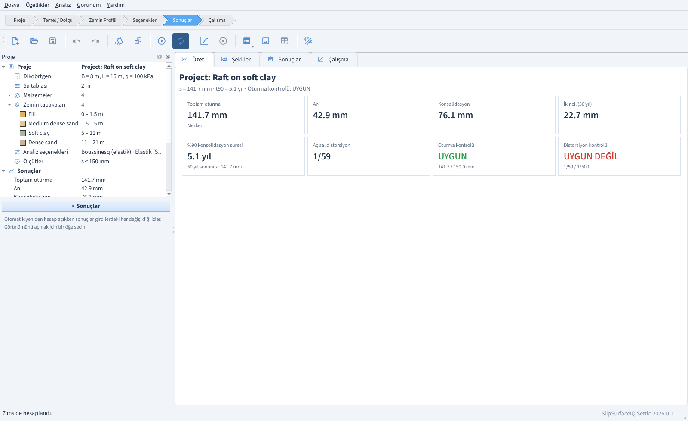
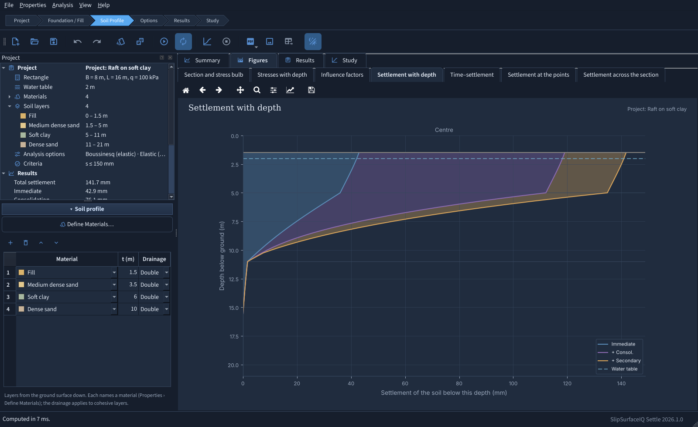
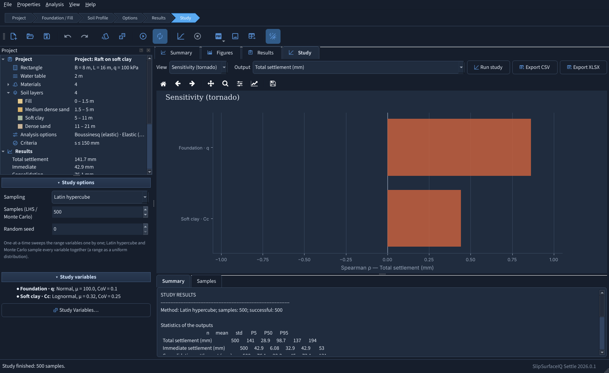
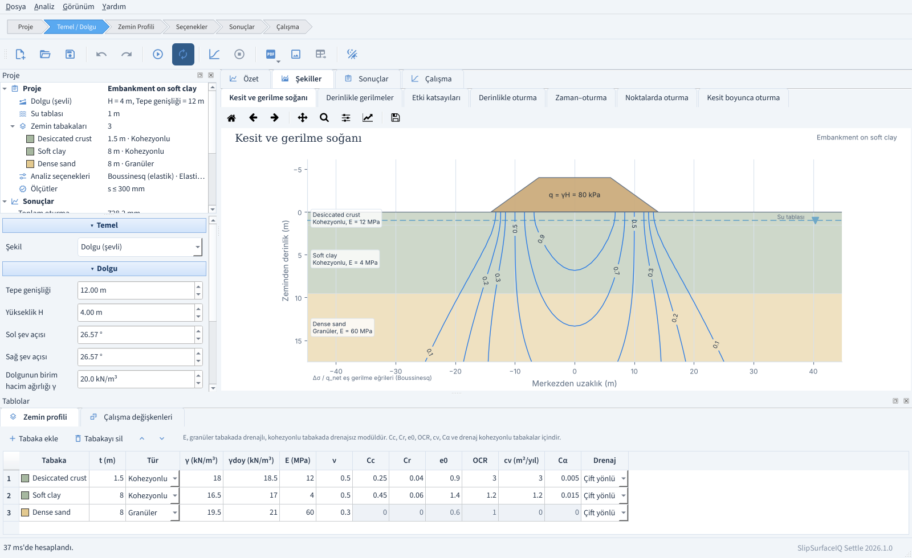
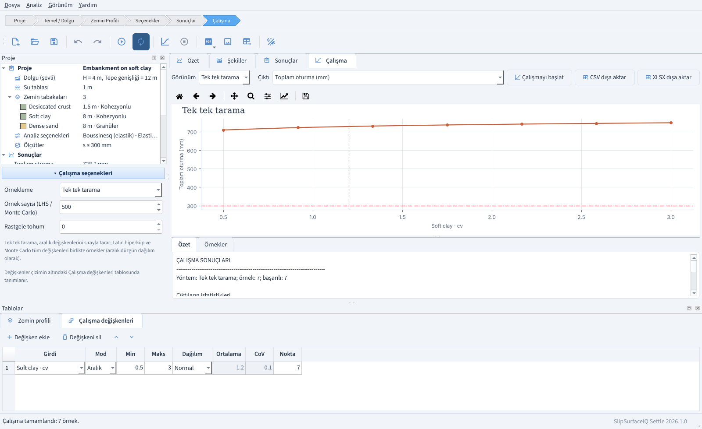
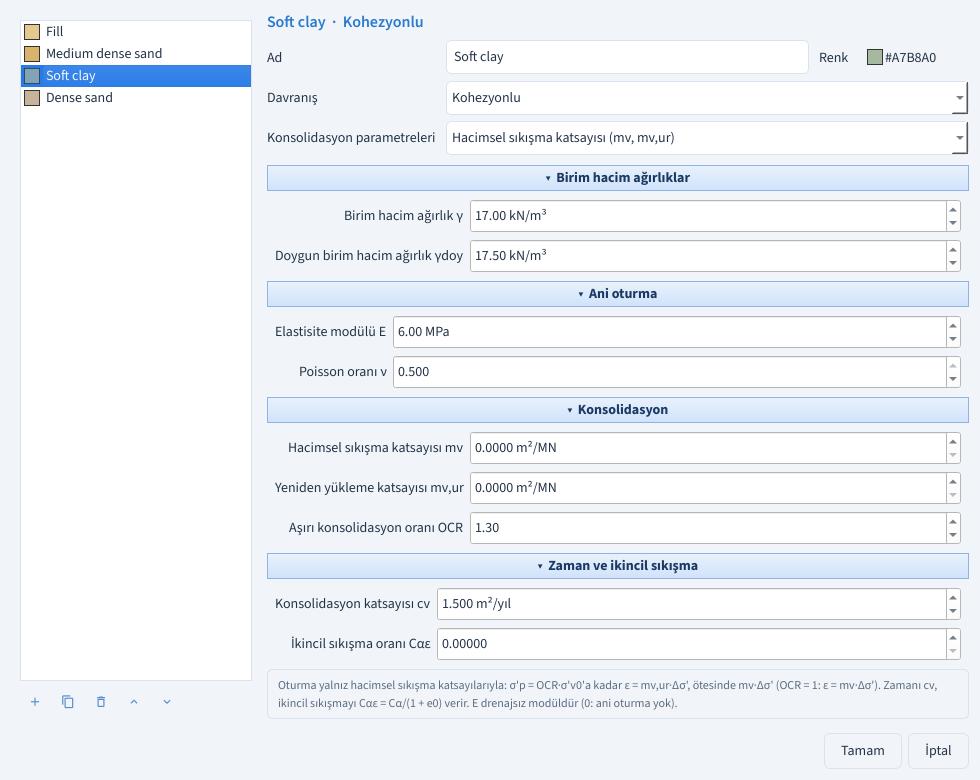
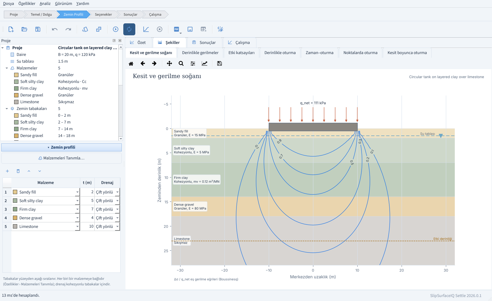

**English** | [Türkçe](README.tr.md)

# SlipSurfaceIQ Settle

**Settlement analysis of shallow foundations and embankments with a desktop interface — version 2026.1.0**

[](https://github.com/hdaltuntas/SlipSurfaceIQ-Settle/actions/workflows/ci.yml)

SlipSurfaceIQ Settle works out **how much** and **how fast** a rectangular, strip or
circular foundation — or an embankment given by its crest width, height and slope
angles — settles on a layered soil profile:

1. **Stresses** — in-situ σv0, u0, σ'v0 and σ'p; the stress increase beneath the foundation
   by Boussinesq (Newmark's rectangle, the strip and the circle solutions) or by the 2:1
   spread, at the centre, the characteristic point, the middle of the long edge and the
   corner; under an embankment, exactly for its trapezoidal load, at the crest centre, the
   crest edge, the middle of the slope and the toe.
2. **Immediate settlement** — layered elastic (Steinbrenner) in every layer, or
   Schmertmann (1978) in the granular layers.
3. **Consolidation** — primary settlement of the clay layers from Cc, Cr, e0 and σ'p, and
   secondary compression from Cα up to the design life.
4. **Time** — Terzaghi's one-dimensional consolidation, each clay layer draining on its own;
   t50, t90 and the time–settlement curve.
5. **Checks** — total settlement and angular distortion against their allowable values.

On top of it, a **parametric or reliability study** sweeps any input — a range, or a
distribution — and reports sensitivities and the probability of exceeding the allowable
settlement or distortion, with a confidence interval and the reliability index β.

It is the desktop sibling of [SlipSurfaceIQ LE](https://github.com/hdaltuntas/SlipSurfaceIQ-LE)
and shares its look: the same workflow bar, docks, icons, themes and fonts. Every label,
result, figure and report is available in **English and Turkish**, switchable at any time
without losing work.

> **Engineering disclaimer.** SlipSurfaceIQ Settle is provided without any warranty.
> Results depend entirely on the soil parameters, loads and groundwater you enter. Review
> them with engineering judgement and, where it matters, with independent calculations.

## Screenshots

| Section and stress bulb | Results summary |
|---|---|
|  |  |

| Settlement with depth, dark theme | Reliability study, tornado |
|---|---|
|  |  |

| Embankment on soft clay | One-at-a-time sweep of cv |
|---|---|
|  |  |

| Define materials: a clay by mv | Soil profile: materials and layers |
|---|---|
|  |  |

## Installation and start-up

**Installers** (no Python needed): Windows MSI, Ubuntu DEB, Fedora / openSUSE RPM and Arch
Linux packages are attached to each [release](https://github.com/hdaltuntas/SlipSurfaceIQ-Settle/releases);
see [packaging/README.md](packaging/README.md).

**From a clone**, with Python 3.10 or newer:

```bash
run_windows.bat            # Windows: creates .venv, installs requirements, starts
./run_linux_mac.sh         # Linux / macOS: the same
```

or by hand:

```bash
pip install -r requirements.txt
python main.py                                   # the window
python main.py slipsurface/settle/examples/strip_on_sand.settle
python main.py --check                           # dependency check, no window
```

`main.py` puts its own folder first on the import path, so no installation is needed and
the file can be opened and run from an IDE (Thonny, Spyder, VS Code …). It can also be
installed: `pip install ".[docx,xlsx]"` gives the `slipsurface-settle` command.

## A typical workflow

The breadcrumb bar at the top walks through the steps; each opens its inputs in the left
dock and the most useful view in the middle.

1. **Project** — title and analyst (they appear in the report header).
2. **Foundation / Fill** — shape, dimensions, depth Df, bearing pressure q (or the
   embankment geometry and unit weight), and the water table. Only the inputs that apply
   to the chosen shape are shown.
3. **Soil Profile** — the layers from the ground surface down, each a material, a
   thickness and, for a clay, the drainage. The materials themselves are defined in
   **Properties › Define Materials…** (Ctrl+M): granular, cohesive or incompressible
   (rock and the like). A cohesive material is described either by its compression
   indices (Cc, Cr, e0) or by its coefficients of volume compressibility (mv, mv,ur),
   with OCR, cv and the secondary compression rate.
4. **Options** — stress distribution, immediate-settlement method, flexible or rigid,
   sublayer thickness, influence depth, design life, creep; allowable settlement and
   distortion.
5. **Results** — summary cards with the checks, a full text listing and seven figures.
6. **Study** — sampling method, number of samples and seed in the left dock; the
   variables (an input with a range or a distribution) in **Properties › Study
   Variables…** (Ctrl+K); results as a sweep, histogram, scatter or tornado chart, a
   summary and the sampled table.

The analysis takes a few milliseconds, so the results and figures follow every committed
input change. Turn **Analysis › Recompute automatically** off to compute only on **F5**;
stale results are then flagged. A study runs in the background with a progress bar and
**Esc** cancels it.

| Key | Action |
|---|---|
| F5 | Compute |
| F6 | Run study |
| Esc | Cancel study |
| Ctrl+N / O / S | New / open / save project |
| Ctrl+M / Ctrl+K | Define materials / study variables |
| Ctrl+Z / Ctrl+Y | Undo / redo any input |
| Ctrl+P | PDF report |
| Ctrl+E | Export the current figure (PNG, SVG, PDF) |
| F1 | Theory manual |

## What it computes

| quantity | method |
|---|---|
| Δσ under a rectangle | Newmark's integration of Boussinesq, superposed for any point |
| Δσ under a strip / circle | closed form / exact one-dimensional integral over the polar angle |
| Δσ under an embankment | exact: Flamant's line load integrated over the piecewise-linear (trapezoidal) load |
| Δσ, approximate | 2:1 spread |
| embankment, immediate | Steinbrenner in plane strain, the crest as one strip and each slope as 16 slices |
| immediate settlement | Steinbrenner F1, F2 on each layer (layered elastic), or Schmertmann (1978) with C1, C2 and the L/B-interpolated influence diagram |
| primary consolidation | Cr up to σ'p = OCR·σ'v0, Cc beyond it, sublayer by sublayer at each point — or ε = mv,ur·Δσ' up to σ'p and mv·Δσ' beyond it |
| incompressible layer | no settlement; its weight counts in the in-situ stresses |
| secondary compression | Cα/(1+e0)·H·log(t/t_p) from U = 95 % to the design life; Cα·Cr/Cc where the clay stays over-consolidated |
| time | Terzaghi U(Tv), per clay layer, H_dr = H/2 or H |
| rigid foundation | settlement of the characteristic point (0.74·B/2, 0.74·L/2; 0.845·R) |
| angular distortion | (s_centre − s_edge) / (B/2) |

The derivations and their limits are in [docs/theory.md](docs/theory.md)
([Türkçe](docs/theory.tr.md)).

## Figures and reports

Section with the Boussinesq stress bulb · stresses with depth (σ'v0, σ'v0 + Δσ, σ'p and the
influence-depth criterion) · influence factors with Schmertmann's Iz · cumulative
settlement with depth · time–settlement curve · settlement components at each point ·
settlement across the section. Every figure can be zoomed, panned and exported.

**File › Report** writes a PDF, a self-contained HTML or a Word report with the inputs, the
stresses, the settlement at each point and in each layer, the Schmertmann factors, the
consolidation times, the checks, the figures, the warnings, the method notes and — if one
was run — the study, in the interface's language.

## Project files (`.settle`) and the command line

A project is a JSON file holding the inputs and the study definition; entries a file does
not carry keep their defaults. The same file runs unattended:

```bash
python main.py example -o project.settle             # a starter project
python main.py run project.settle -o report.pdf      # analyse, print, write a report
python main.py study project.settle -o samples.csv   # run the study, write the samples
```

(Installed: `slipsurface-settle-cli run …`.)

## Project layout

| path | content |
|---|---|
| `slipsurface/settle/stress.py` | Boussinesq (rectangle, strip, circle, embankment), 2:1, Steinbrenner |
| `slipsurface/settle/consolidation.py` | Terzaghi U(Tv) and its inverse, compression of clay, secondary compression |
| `slipsurface/settle/engine.py` | The settlement analysis: profile, sublayers, points, checks, time curve |
| `slipsurface/settle/study.py`, `study_plots.py` | Parametric and reliability studies, statistics, P of exceedance with 95 % CI and β, Spearman sensitivities, CSV / XLSX |
| `slipsurface/settle/plotting.py`, `plot_style.py`, `render.py` | Matplotlib figures, theme-aware |
| `slipsurface/settle/report.py`, `pdfwriter.py` | Calculation report: one HTML assembly, exported as PDF (reportlab), HTML or DOCX |
| `slipsurface/settle/forms.py` | Input schema the interface is built from; flat values ↔ engine configuration |
| `slipsurface/settle/session.py` | One working session: analyse, study, report, project files (no GUI) |
| `slipsurface/settle/summary.py`, `i18n.py` | Results as cards and text; every text in English and Turkish |
| `slipsurface/settle/ui/` | The PySide6 desktop interface |
| `slipsurface/settle/examples/` | Bundled example projects |
| `packaging/` | PyInstaller and native installer recipes |

## Development

```bash
pip install -r requirements-dev.txt
pytest -q          # engine, stresses, study, report, packaging and the interface (offscreen)
ruff check . && ruff format --check .
```

The tests check the stress solutions against published values and brute-force integrals,
the engine against closed-form cases, the report in all three formats, the input schema and
its file round-trips, and the desktop interface itself, driven offscreen.

## Independent project

SlipSurface is an independent project for geotechnical and rock engineering, developed by
Hasan Deniz Altuntaş ([slipsurface.dev](https://slipsurface.dev), slipsurface@proton.me).
It is not affiliated with, endorsed by, or connected to any other company or product using
a similar name.

## License

© 2026 Hasan Deniz Altuntaş — [GNU AGPL v3 or later](LICENSE). No warranty.
